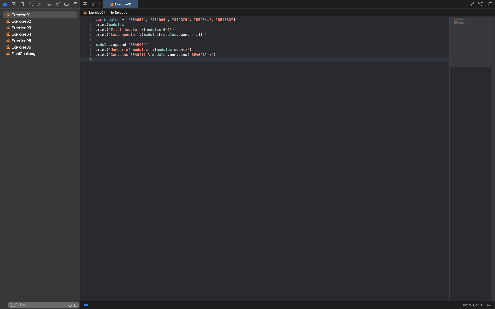
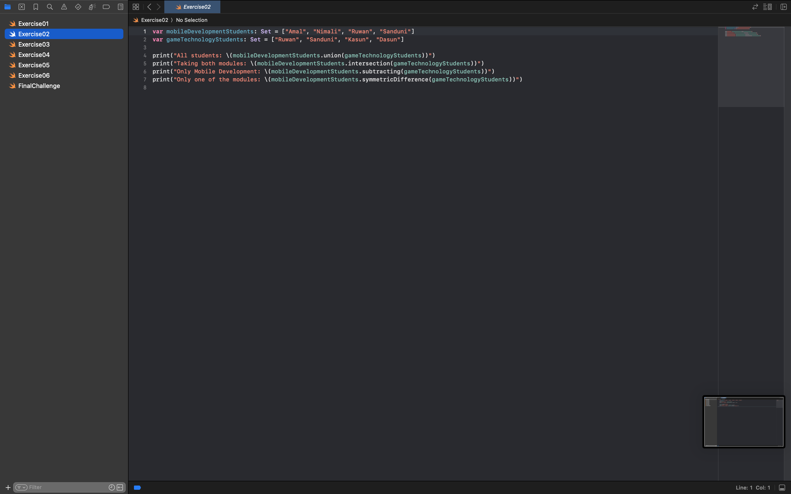
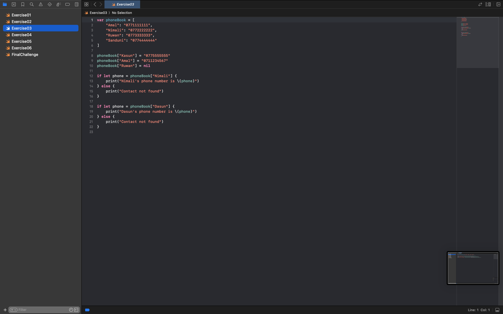
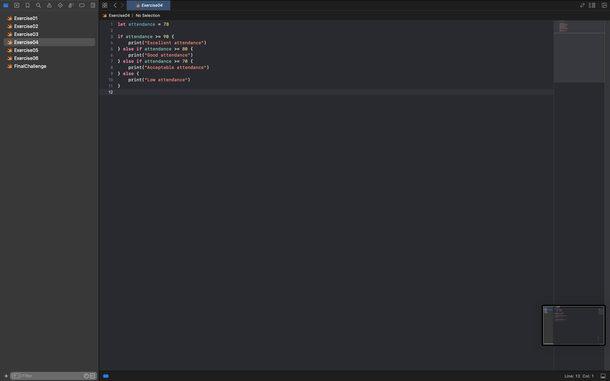
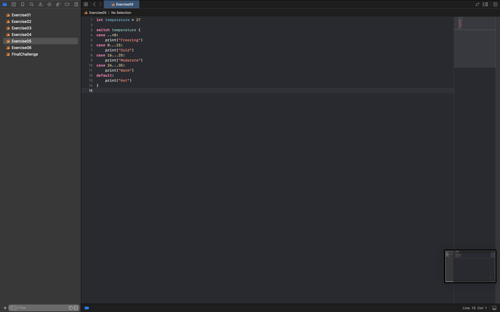
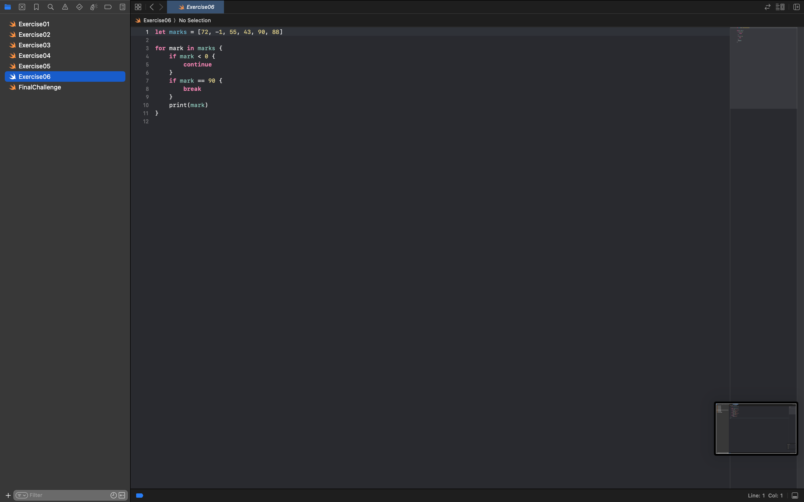

# SE4041 – Practical 02 – Swift Collections & Control Flow

- **Student Name:** Jayasundara R.K.M.J.Y
- **Student ID:** IT22136374
- **Module:** SE4041 – Mobile Application Development
- **Practical:** Practical 02 (Lab 02)
- **Environment Used:** Xcode Playground / Swift 5+

---

## Overview

This repository contains solutions and execution evidence for **SE4041: Practical 02**. The lab focuses on core Swift programming concepts including collections (**Arrays**, **Sets**, **Dictionaries**), control flow (**If-Else**, **Switch statements with pattern matching and ranges**), control transfer statements (**break**, **continue**), and an integrated **Final Challenge** performing comprehensive student performance evaluation and statistics calculation.

---

## Repository Structure

| File | Description | Screenshot Evidence |
| :--- | :--- | :--- |
| [`Exercise01.swift`](Exercise01.swift) | Swift Arrays: indexing, appending, counting, membership check | [`Ex01.png`](Screenshots/Ex01.png) |
| [`Exercise02.swift`](Exercise02.swift) | Swift Sets: set operations (`union`, `intersection`, `subtracting`, `symmetricDifference`) | [`Ex02.png`](Screenshots/Ex02.png) |
| [`Exercise03.swift`](Exercise03.swift) | Swift Dictionaries: modifying values, key removal, safe optional binding | [`Ex03.png`](Screenshots/Ex03.png) |
| [`Exercise04.swift`](Exercise04.swift) | Conditional Statements: `if`, `else if`, `else` attendance evaluation | [`Ex04.png`](Screenshots/Ex04.png) |
| [`Exercise05.swift`](Exercise05.swift) | Switch Statements: pattern matching with closed and half-open ranges | [`Ex05.png`](Screenshots/Ex05.png) |
| [`Exercise06.swift`](Exercise06.swift) | Control Transfer Statements: filtering and breaking loops (`continue`, `break`) | [`Ex06.png`](Screenshots/Ex06.png) |
| [`FinalChallenge.swift`](FinalChallenge.swift) | Comprehensive Student Performance System: grading, analytics, and lookups | [`Final Challange_SS1.png`](Screenshots/Final%20Challange_SS1.png)<br>[`Final Challange_SS2.png`](Screenshots/Final%20Challange_SS2.png) |

---

## Practical Exercises & Evidence

### 1. Exercise 01 – Swift Arrays
- **File:** [`Exercise01.swift`](Exercise01.swift)
- **Concepts:** Initializing an array of module strings, accessing the first element via index `0` and the last element dynamically using `modules.count - 1`, appending items with `.append()`, retrieving total element count, and verifying element existence with `.contains()`.



---

### 2. Exercise 02 – Swift Sets & Set Operations
- **File:** [`Exercise02.swift`](Exercise02.swift)
- **Concepts:** Creating distinct sets of student names for different courses and performing mathematical set operations:
  - **Union (`.union`):** All unique students across both modules.
  - **Intersection (`.intersection`):** Students enrolled in both modules.
  - **Subtracting (`.subtracting`):** Students enrolled only in Mobile Development.
  - **Symmetric Difference (`.symmetricDifference`):** Students taking exactly one module, but not both.



---

### 3. Exercise 03 – Swift Dictionaries & Optionals
- **File:** [`Exercise03.swift`](Exercise03.swift)
- **Concepts:** Managing key-value pairs in a phone book dictionary, inserting a new contact, modifying an existing contact's value, removing a key by assigning `nil`, and safely unwrapping dictionary lookups using `if let` optional binding.



---

### 4. Exercise 04 – Conditional Logic (`if` / `else if` / `else`)
- **File:** [`Exercise04.swift`](Exercise04.swift)
- **Concepts:** Evaluating an integer attendance percentage using chained conditional branches to classify attendance records into *Excellent*, *Good*, *Acceptable*, or *Low*.



---

### 5. Exercise 05 – Switch Statements with Ranges
- **File:** [`Exercise05.swift`](Exercise05.swift)
- **Concepts:** Pattern matching against numerical ranges in a `switch` statement using one-sided ranges (`..<0`), closed ranges (`0...15`, `16...25`, `26...35`), and a fallback `default` case to classify temperature readings.



---

### 6. Exercise 06 – Control Transfer Statements (`continue` & `break`)
- **File:** [`Exercise06.swift`](Exercise06.swift)
- **Concepts:** Iterating over numerical test marks in a loop, utilizing `continue` to ignore invalid negative numbers, and `break` to halt loop execution early upon encountering a specific threshold value.



---

### 7. Final Challenge – Student Performance Evaluation System
- **File:** [`FinalChallenge.swift`](FinalChallenge.swift)
- **Concepts:** Integrated application combining all concepts learned:
  - Storing students and marks in a `[String: Int]` dictionary.
  - Categorizing letter grades (A through F) with a range-based `switch` block.
  - Tracking unique awarded grades using a `Set<String>`.
  - Filtering and compiling passed students into an array while tallying pass/fail counts.
  - Computing summary statistics: sum (`.reduce`), class average, highest mark (`.max()`), and lowest mark (`.min()`).
  - Student record lookup using optional binding (`if let`).

#### Execution Evidence (Part 1):


#### Execution Evidence (Part 2):


---

## How to Run the Code

You can run any of the Swift scripts using Xcode Playgrounds or directly from the terminal with the Swift compiler:

```bash
# Run individual exercises
swift Exercise01.swift
swift Exercise02.swift
swift Exercise03.swift
swift Exercise04.swift
swift Exercise05.swift
swift Exercise06.swift

# Run Final Challenge
swift FinalChallenge.swift
```
